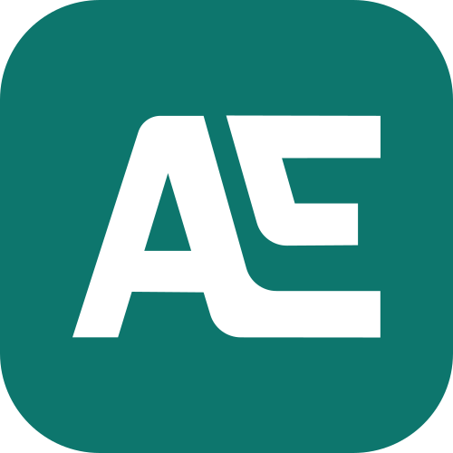
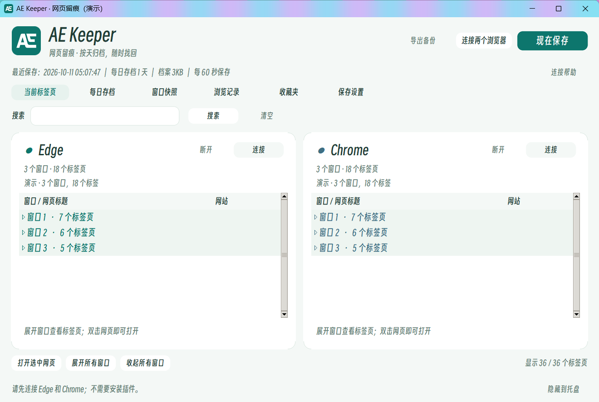
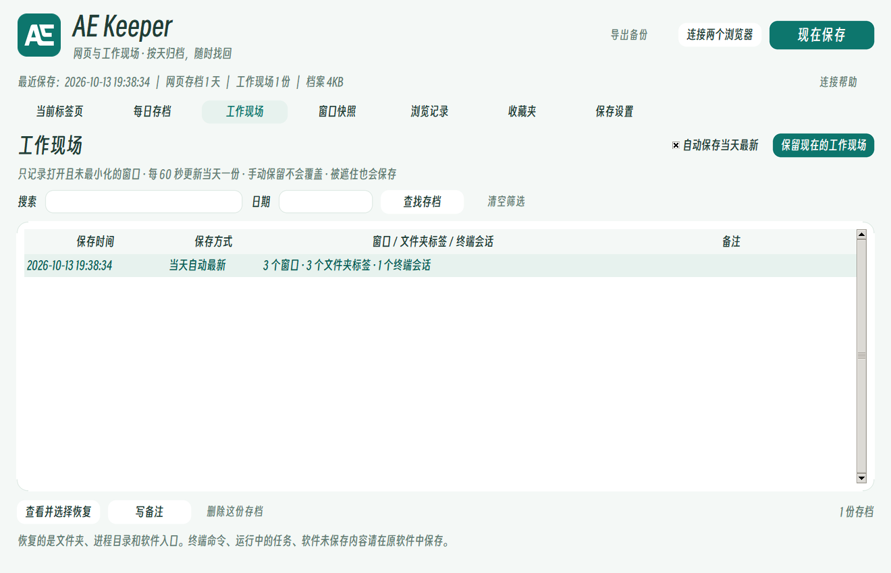

<p align="center">
  
</p>

# AE Keeper · 网页留痕

AE 系列中的网页保存工具。一个 Windows 桌面软件同时保存 Edge 与 Chrome 的窗口和标签页，按天归档，随时找回。

采用海松绿与浅薄荷白配色，沿用 AE 系列标识；应用内使用得意黑。Windows 11 支持圆角窗口与 Acrylic 标题栏。

当前版本：**0.3.0**。适用于 Windows，采用 MIT 许可证。



*截图使用演示数据，不包含真实浏览记录。*

## 功能

- 无需浏览器扩展，连接本机 Chrome、Edge 后读取所有可见窗口；默认排除无痕。
- 定时保存窗口快照，记录观察到的网页，合并检索两种浏览器的书签。
- 每天保留一份自动最新的完整双浏览器快照；支持额外保留多份、指定主存档和按原浏览器窗口恢复。
- 本地 SQLite 档案，JSON 导入导出。无需账户，不上传浏览内容。
- 工作现场：每天保存未最小化的桌面窗口、资源管理器多标签路径、可读取的终端进程目录；可额外手动保留并选择恢复。



## 运行

需要 Windows 10/11、Python 3.13 及支持现有实例连接接口的 Chrome/Edge。本版本主要在 Windows 11 和两种浏览器 154 版本验证。

```powershell
python -m venv .venv
.\.venv\Scripts\python -m pip install -r requirements.txt
.\.venv\Scripts\python app.py
```

## 连接浏览器

1. 启动软件，点击“连接两个浏览器”，也可以在 Edge 或 Chrome 栏中单独点击“连接”。
2. 在对应浏览器的设置页开启“Allow remote debugging for this browser instance”（允许对此浏览器实例进行远程调试）：Chrome 为 `chrome://inspect/#remote-debugging`，Edge 为 `edge://inspect/#remote-debugging`。
3. 浏览器弹出连接请求时点击“允许”，回到软件确认两个浏览器均显示“已连接”，再展开各窗口检查标签页。

软件不会代替用户授权；拒绝或超时后不会反复请求。重启后需要重新连接。如果设置页没有对应开关，当前浏览器版本或组织策略可能不支持这种连接方式。

默认每 60 秒保存一次，可在“保存设置”中调整。浏览记录保存的是软件运行并成功读取期间观察到的网页；两次采样之间打开后又关闭的页面可能没有被记录。

## 每日存档

每天自动更新一份最新的完整 Edge + Chrome 快照。在“窗口快照”中选中历史快照，可以把它加入指定日期的每日文件夹，选择替换主存档或额外保留。

只有一份时直接显示；有多份时展开日期，查看其他快照并设置主存档。手动指定的主存档不会被后续自动保存覆盖。恢复时按浏览器和窗口打开可用的网页网址；登录状态、标签组和固定标签页不保证还原。

## 数据与兼容性

### 工作现场

“工作现场”默认按同一保存间隔自动更新当天的一份非空存档，也支持“保留现在的工作现场”留下额外的独立记录。最小化、隐藏、托盘、工具弹窗和其他虚拟桌面的不可见窗口不在采集范围；被其他窗口遮住的普通窗口会保存。没有窗口时保留已有当天存档。

同一天重新启动 AE Keeper 时，先把上次的自动快照保留为“上次运行保留”，再更新当前现场，避免启动后的空工作环境覆盖重启前的进度。软件运行时才会自动采集；可在“保存设置”开启安装版开机启动，也可用 `--workspaces` 直接打开此栏目。恢复始终由用户选择后发起，不会在开机时自动执行命令或打开所有软件。

资源管理器通过 Shell COM 读取同一窗口的文件夹标签页。恢复会创建新窗口，再为它添加标签页，不导航或关闭已有窗口。Windows 10 等不支持标签页的系统会退回独立窗口；不存在的路径跳过，标签顺序与选中项不保证一致。

Windows Terminal 在能把宿主对应到一个窗口时读取 shell 子进程的目录；宿主有多个窗口且无法可靠对应时只保留软件入口，不推测会话归属。恢复为新的 shell 标签页，分屏会展开成标签页。**进程目录可能与 PowerShell 等 shell 的逻辑 `pwd` 不同**；不能接续命令、进程、终端滚动内容、环境变量或 WSL 会话。不会采集或重放 shell 命令行。

其他软件保存标题、入口和窗口位置，恢复前可自行勾选；不保证恢复项目、文档或未保存内容。浏览器网页继续使用“每日存档”恢复。窗口布局在能可靠识别新窗口时尽量还原；显示器变化后会限制在当前桌面可见范围。

工作现场单独预留默认 20 MB（可在保存设置调至 5—200 MB），与浏览器共享保留天数。自动保存开关位于“工作现场”栏目。导出完整备份包含这些窗口和本地路径，请自行确认可公开的内容。旧备份没有工作现场字段也可以导入。

参考：[微软 ShellWindows 文档](https://learn.microsoft.com/en-us/windows/win32/shell/shellwindows)、[Windows Terminal 启动参数](https://learn.microsoft.com/en-us/windows/terminal/command-line-arguments)。

### 浏览器档案

不读取 Cookie、登录凭据或网页正文。标题与网址可能包含个人信息，请谨慎分享导出的档案。恢复网址需要网络和原网站登录状态；不能把未读取到的网址或未运行期间的变化补回来。

旧版“浏览留痕”的档案、安装目录和备份格式继续兼容。名称更新不会迁移或清空原数据。默认档案路径：`%LOCALAPPDATA%\BrowseTraceDesktop\data\archive.sqlite3`。

## 验证与打包

```powershell
python -m unittest discover -s tests
python -m pip install pyinstaller
python -m PyInstaller --noconfirm --onefile --windowed --name AEKeeper --icon assets/ae-keeper.ico --version-file version_info.txt --add-data "assets;assets" --hidden-import win32com.client app.py
```

生成的程序可直接运行。以 `--install` 启动安装界面，或把安装副本命名为 `AE Keeper-安装.exe`。安装到当前用户目录并生成 AE Keeper 桌面快捷方式。

演示模式使用本地示例网址，不连接实际浏览器：

```powershell
python app.py --demo --data-dir ./demo-data
```

## 开源与资源

软件代码采用 MIT 许可证，见 LICENSE。AE 图形来自项目维护者提供的 `ae.svg`，保留原始轮廓；资源中只保留可见矢量路径，不包含原文件里隐藏的参考图片。得意黑采用 SIL Open Font License 1.1，许可证附在 `assets/SmileySans-LICENSE.txt`。

源码包不包含浏览器个人资料、实际浏览记录、数据库或用户备份。分享仓库时请按 `.gitignore` 排除这些文件。

## 参与开发

欢迎通过 [Issues](https://github.com/YongstVenti/AE-Keeper/issues) 反馈问题，或提交 Pull Request。修改保存、导入或每日存档逻辑后，请运行上面的单元测试。

报告连接问题时请注明 Windows 和浏览器版本；提供截图、日志或示例备份前，请移除其中的私人网址和浏览记录。演示模式适合制作公开截图。
